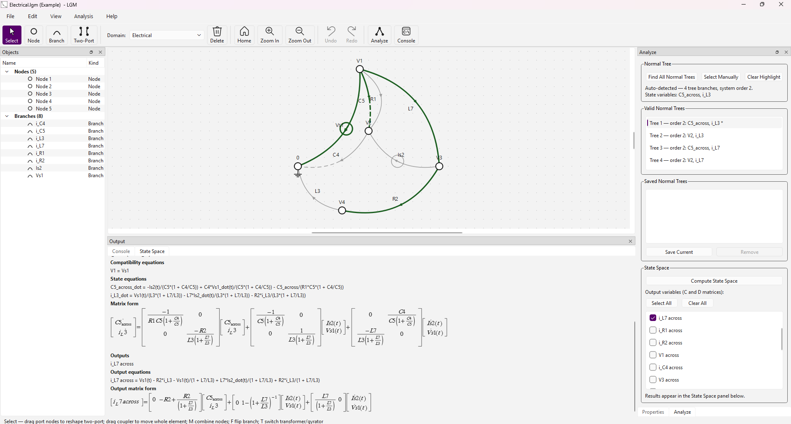

# Linear Graph Modeling (LGM)

A Qt6 desktop editor for **MIT-style linear graphs**: draw nodes, directed branches, and two-port elements on a snapping grid, then derive **normal trees** and **state-space equations** from the model.

The app targets coursework-style system dynamics (mechanical, electrical, fluid, thermal, and rotational domains) following the linear graph formulation used in MIT 2.151.



**Download:** [v0.4.2](https://github.com/FurkanKaraketir/LGM/releases/tag/v0.4.2) — Windows installer or portable zip, macOS `.dmg` or portable zip, Linux AppImage.

**Documentation:** [GitHub Wiki](https://github.com/FurkanKaraketir/LGM/wiki) — user guides, theory, and developer reference (synced from `docs/`).

## Features

| Area | What it does |
|------|----------------|
| [Canvas editor](docs/canvas.md) | CAD-style graph drawing, selection, undo/redo, `.lgm` files |
| [Graph model](docs/model.md) | Branch types (A/T/D), domains, elemental equations, two-ports |
| [Analysis](docs/analysis.md) | Normal-tree search, manual tree selection, state-space derivation, MATLAB® export |
| [Examples](Examples/README.md) | Sample `.lgm` graphs (motor, pump–accumulator, RLC, gyrator, transformer cascade, floating source, multiple normal trees) |

In-app guides: **Help → Guides** (Quick Start, Multiple Normal Tree Finding, State-Space Derivation).

## License

Copyright (C) 2026 Furkan Karaketir

This program is free software under the [GNU General Public License v3.0](https://www.gnu.org/licenses/gpl-3.0.html) (or later). See [COPYING](COPYING).

## Requirements

- CMake 3.16+
- Qt 6.11 (Widgets, Network) — same version as CI and `CMakePresets.json` `windows-mingw`
- C++17 compiler (MinGW or MSVC on Windows)
- [vcpkg](https://vcpkg.io/) (Boost.Multiprecision)
- Network access on first configure (SymEngine and JKQtPlotter are fetched via CMake `FetchContent`)

## Build (Windows, Qt MinGW)

Machine-specific Qt/vcpkg paths are in the `windows-mingw` preset in `CMakePresets.json`. Edit that preset if your install paths differ (or copy `CMakeUserPresets.json.example` to `CMakeUserPresets.json` and add overrides).

**Configure once**:

   ```powershell
   cmake --preset windows-mingw
   ```

**Build and run** (day to day):

   ```powershell
   cmake --build build
   .\build\LGM.exe
   ```

`windeployqt` runs automatically after the build when available, copying Qt runtime DLLs next to the executable.

macOS and Linux use the `ci-macos` / `ci-linux` presets: see [Building from source](https://github.com/FurkanKaraketir/LGM/wiki/Building-from-source).

**Tests** (canvas regression and analysis checks):

   ```powershell
   cmake --preset windows-mingw -DLGM_BUILD_TESTS=ON
   cmake --build build --target lgm_canvas_tests
   ctest --test-dir build --output-on-failure
   ```

Analysis output for the examples is pinned by golden files: `docs/publication/benchmarks/check.ps1` (see [benchmarks](docs/publication/benchmarks/README.md)).

## Releases and updates

Tagged releases (`v0.4.2` is the latest) are built for Windows, macOS, and Linux via GitHub Actions and published on [GitHub Releases](https://github.com/FurkanKaraketir/LGM/releases).

| Platform | Installer | Portable |
|----------|-----------|----------|
| Windows | `LGM-x.y.z-win64-setup.exe` | `LGM-x.y.z-win64-portable.zip` |
| macOS 13+ (Apple Silicon) | `LGM-x.y.z-macos-arm64.dmg` | `LGM-x.y.z-macos-arm64-portable.zip` |
| macOS 13+ (Intel) | `LGM-x.y.z-macos-x86_64.dmg` | `LGM-x.y.z-macos-x86_64-portable.zip` |
| Linux (glibc 2.35+: Ubuntu 22.04, Debian 12 or newer) | `LGM-x.y.z-linux-x86_64.AppImage` | — |

- Maintainer guide: [docs/releases.md](docs/releases.md)
- In-app: **Help → Check for Updates**

## Quick workflow

1. Pick a **domain** from the toolbar (or **Settings**).
2. Draw the graph: nodes, branches, two-ports.
3. Edit names, constants, and branch types in the **Properties** dock.
4. Open **Analyze** → **Find All Normal Trees** or select a **normal tree** manually → (optional) check **output variables** → **Compute State Space**.
5. Review state equations (`ẋ = Ax + Bu`) and, when outputs were selected, output equations (`y = Cx + Du`) in the **State Space** dock (LaTeX via JKQtMathText).
6. **Export MATLAB® Script** (Analyze dock) saves `A`, `B`, `C`, `D`, and related matrices as a `.m` file for MATLAB®.

See [docs/canvas.md](docs/canvas.md) for controls and [docs/analysis.md](docs/analysis.md) for the analysis pipeline.

## Example result

[Examples/Electrical.lgm](Examples/Electrical.lgm) with the alternative normal tree that leaves `i_L7` in the co-tree (states `C5_across`, `i_L7`) and outputs `i_L7 across` and `i_R1 across` selected. Here $v_{C5}$ is `C5_across`, and the outputs $v_{L7}$, $v_{R1}$ are the across variables of `i_L7` and `i_R1`:

$$
\dot{x} = A x + B u + E \dot{u}, \qquad y = C x + D u + F \dot{u}, \qquad
x = \begin{bmatrix} v_{C5} \cr i_{L7} \end{bmatrix}, \quad
u = \begin{bmatrix} I_{s2} \cr V_{s1} \end{bmatrix}, \quad
y = \begin{bmatrix} v_{L7} \cr v_{R1} \end{bmatrix}
$$

$$
A = \begin{bmatrix} -\dfrac{1}{R_1 C_4 + R_1 C_5} & 0 \cr 0 & -\dfrac{R_2}{L_3 + L_7} \end{bmatrix}, \quad
B = \begin{bmatrix} -\dfrac{1}{C_4 + C_5} & 0 \cr \dfrac{R_2}{L_3 + L_7} & \dfrac{1}{L_3 + L_7} \end{bmatrix}, \quad
E = \begin{bmatrix} 0 & \dfrac{C_4}{C_4 + C_5} \cr \dfrac{L_3}{L_3 + L_7} & 0 \end{bmatrix}
$$

$$
C = \begin{bmatrix} 0 & -\dfrac{R_2 L_7}{L_3 + L_7} \cr 1 & 0 \end{bmatrix}, \quad
D = \begin{bmatrix} \dfrac{R_2 L_7}{L_3 + L_7} & \dfrac{L_7}{L_3 + L_7} \cr 0 & 0 \end{bmatrix}, \quad
F = \begin{bmatrix} \dfrac{L_3 L_7}{L_3 + L_7} & 0 \cr 0 & 0 \end{bmatrix}
$$

**Export MATLAB® Script** writes the same matrices as `A`, `B`, `E` (state) and `C`, `D`, `F` (output):

```matlab
% State-space model generated by LGM
% MATLAB and Simulink are registered trademarks of The MathWorks, Inc. See mathworks.com/trademarks for additional trademarks.
%
% x_dot = A*x + B*u + E*u_dot
% y = C*x + D*u + F*u_dot

% Parameters (default value 1)
C4 = 1;
C5 = 1;
L3 = 1;
L7 = 1;
R1 = 1;
R2 = 1;

% States: C5_across, i_L7
% Inputs: Is2(t), Vs1(t)
% Outputs: i_L7 across, i_R1 across

A = [-1/(R1*C4 + R1*C5), 0; 0, -R2/(L3 + L7)];
B = [-1/(C4 + C5), 0; R2/(L3 + L7), (L3 + L7)^(-1)];
E = [0, C4/(C4 + C5); L3/(L3 + L7), 0];
C = [0, -R2*L7/(L3 + L7); 1, 0];
D = [R2*L7/(L3 + L7), L7/(L3 + L7); 0, 0];
F = [L3*L7/(L3 + L7), 0; 0, 0];
```

The input-derivative terms (`E`, `F`) come from the dependent storage elements — capacitor `C4` (a co-tree link) and the inductor left in the tree — whose constraints are differentiated during the solve ([details](docs/state_space_from_normal_tree.md)). The default tree (`--analyze`, golden output) picks `i_L3` as the state instead; the two models are equivalent through KCL (`i_L7 = i_L3 + Is2`).

---

MATLAB and Simulink are registered trademarks of The MathWorks, Inc. See [mathworks.com/trademarks](https://www.mathworks.com/company/trust-center/trademarks.html) for additional trademarks.

## Project layout

```
CMakeLists.txt          # build + vcpkg / FetchContent deps
Examples/               # sample .lgm graphs
docs/                   # feature docs, algorithm reference, theory handouts, publication notes
scripts/                # packaging (Windows/macOS/Linux) and wiki sync
tests/                  # canvas regression + analysis tests (LGM_BUILD_TESTS)
wiki/                   # hand-written wiki pages (Home, FAQ, build guide)
src/
  canvas/
    canvas.h              # GraphScene, items, modes, analysis hooks
    items/                # geometry, node, branch, two-port items
    scene/                # lifecycle, merge, normal-tree UI, state-space trigger
    document/             # .lgm load/save
    undo/                 # undo stack commands
    canvas_view.cpp       # zoom, pan, grid
    canvas_scene_input.cpp
    canvas_scene_delete.cpp
  model/
    elemental_equation/   # constants, naming, symbols, topology
    normal_tree/          # search, enumeration, public API
    state_space/          # context, constraints, linear-system solve, matrix assembly
    state_space_*.cpp     # SymEngine solve, graph walks, LaTeX, MATLAB export
  ui/
    mainwindow.h
    mainwindow/           # chrome (menu, toolbar, docks), panels, file I/O
    analyze_window.cpp    # Analyze dock
    settings_window.cpp
    guide_window.cpp
    app_*.cpp             # log, settings, shortcuts, update check
    main.cpp              # GUI entry and --analyze CLI
  assets/               # icons, in-app guides, app icon
```

## Background reading

Theory and graph assembly follow Altun, Kerem; Balkan, R. Tuna; & Platin, Bülent (2002), *Extraction of state variable representations of dynamic systems employing linear graph theory* ([doi:10.13140/RG.2.2.29940.96647](https://doi.org/10.13140/RG.2.2.29940.96647)).

Symbolic elimination of assembled linear constraints (Phase F) follows Geddes, K. O.; Czapor, S. R.; & Labahn, G. (1992), *Algorithms for Computer Algebra*, Ch. 9 §9.2 *Linear Equations and Gaussian Elimination* ([Springer](https://link.springer.com/book/10.1007/b102438)).

Course handouts in `docs/` (not part of the build; also on the wiki):

- [docs/LinearGrpahModelingBasics.txt](docs/LinearGrpahModelingBasics.txt) — state equations from linear graphs
- [docs/TwoPortsBasics.txt](docs/TwoPortsBasics.txt) — transformers, gyrators, multi-domain graphs

Algorithm detail (developer reference with source links): [docs/state_space_from_normal_tree.md](docs/state_space_from_normal_tree.md). In-app guides: **Help → Guides → Multiple Normal Tree Finding** (enumeration) and **State-Space Derivation** (logic only, no file links).

Technical analysis (originality, heuristics, literature): [docs/publication/README.md](docs/publication/README.md).
