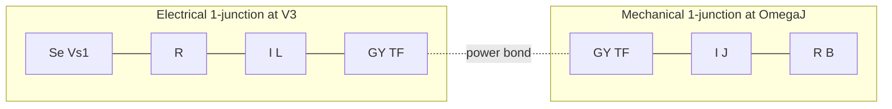

# Bond-graph reference: PM DC motor (Motor.lgm)

Textual bond-graph companion to [`Motor.mo`](Motor.mo) and [`Examples/Motor.lgm`](../../../Examples/Motor.lgm). Effort \(e\) / flow \(f\) notation (Borutzky / 20-sim style).

## Graph

| LGM branch | Bond-graph element | Effort | Flow |
|------------|-------------------|--------|------|
| `Vs1` | Se (source effort) | \(V_1\) | \(i_{Vs1}\) |
| `i_R` | R | \(V_R\) | \(i_R\) |
| `i_L` | I (inertance \(L\)) | \(V_L\) | \(i_L\) |
| Transformer `TF` | TF or GY (modulus \(TF\)) | \(V_3 = TF \cdot \Omega_J\) | \(T_2 = -T_{port}/TF\) |
| `T_J` | I (\(J\)) | \(\Omega_J\) | \(T_J\) |
| `T_B` | R (\(B\)) | \(\Omega_J\) | \(T_B\) |

## Causal assignment (one valid stroke pattern)

| Element | Causality | State |
|---------|-----------|-------|
| Se | effort out | input \(u = V_{s1}\) |
| R | \(e\) in, \(f\) out | — |
| I (L) | \(f\) out | **\(x_1 = i_L\)** |
| TF | \(e_1\) in, \(f_2\) out | — |
| I (J) | \(f\) out | **\(x_2 = \Omega_J\)** |
| R (B) | \(e\) in, \(f\) out | — |

Bond-graph state count: **2** (same as LGM `OmegaJ`, `i_L`).

## Dynamic equations (linear)

Constitutive:

- \(L \dot{i}_L = e_L\)
- \(J \dot{\Omega}_J = T_J\)
- \(e_R = R i_R\), \(T_B = B \Omega_J\)
- Transformer: \(V_3 = TF \cdot \Omega_J\), \(i_1 = TF \cdot T_2\) (sign per LGM port orientation)

Junction (continuity / compatibility):

- Electrical 1-junction: \(i_{Vs1} = i_R = i_L = i_1\); \(V_1 = V_R + V_L + V_3\)
- Mechanical 1-junction: \(T_J = T_2 + T_B\); \(\Omega_J\) common

With grounded source \(V_1 = u\), eliminate algebraic efforts to obtain LGM golden:

\[
\dot{\Omega}_J = -\frac{B}{J}\Omega_J + \frac{TF}{J} i_L
\]
\[
\dot{i}_L = \frac{u}{L} - \frac{R}{L} i_L - \frac{TF}{L}\Omega_J
\]

Matches [`benchmarks/golden/Motor.txt`](../benchmarks/golden/Motor.txt).

## Friction vs LGM

| Aspect | Bond graph | LGM linear graph |
|--------|------------|------------------|
| State selection | Causal stroke before assembly | Normal tree |
| Coupling | TF on bond | Two-port transformer branches |
| \(\dot{u}\) term | Appears if Se receives integral causality | LGM Motor has no \(E\dot{u}\) for grounded `Vs1` |

See [cross_tool_comparison.md](../cross_tool_comparison.md).
