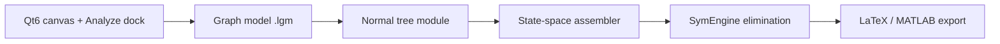

# LGM: Symbolic State-Space Derivation from MIT Linear Graphs for Control Education

**Draft for ECC27 (European Control Conference 2027)**  
**Target topics:** Modeling · Control Education · Linear Systems · Mechatronics  
**Status:** Working draft — July 2026  
**Authors:** Furkan Karaketir¹, Kerem Altun¹ *(affiliations TBD)*

Companion material: [literature_review.md](literature_review.md), [cross_tool_comparison.md](cross_tool_comparison.md), [benchmarks/golden/](benchmarks/golden/), [heuristics_formalization.md](heuristics_formalization.md).

---

## Abstract

Linear graph modeling teaches students to derive state equations from an energy-based graphical representation, yet most system-dynamics courses still rely on hand manipulation of cut-set and tie-set equations. We present **LGM** (Linear Graph Modeling), an open-source desktop application that accepts a user-drawn MIT-style linear graph and produces **symbolic** state-space models \(\dot{x} = Ax + Bu + E\dot{u}\), \(y = Cx + Du + F\dot{u}\) via computer algebra (SymEngine). The tool implements the normal-tree procedure of Altun, Balkan and Platin (2002) and MIT 2.151 course material, extended with engineering heuristics for multi-domain coursework graphs (cascaded transformers, floating sources, dependent storage). A validation corpus of seven example systems—including a permanent-magnet DC motor, a coupled RLC network with derivative inputs, and a pump–accumulator plant—provides reproducible golden outputs through a command-line interface. A cross-formalism comparison with bond-graph and Modelica workflows shows that commercial tools either use a different graphical formalism (20-sim) or linearize acausal DAE models at an operating point (OpenModelica), whereas LGM exports closed-form rational expressions directly from the linear graph. To our knowledge, no other open or proprietary package offers this combination for the MIT linear-graph formalism. LGM is released under GPL-3.0 for Windows, macOS, and Linux and is intended as a hands-on companion for modeling and control education.

**Keywords:** linear graphs, normal tree, state-space realization, symbolic computation, control education, mechatronics modeling.

---

## 1. Introduction

Graphical modeling methods connect physical system topology to differential equations. Two closely related traditions are **bond graphs** (Paynter, 1961) and **MIT linear graphs** (Koenig et al., 1967; Rowell & Wormley, 1997). Both use port-based across and through variables, but they differ in how causality and state variables are chosen: bond graphs assign a causal stroke to each bond; linear graphs select a **normal tree** that maximizes across-type storage in the tree and through-type storage in the co-tree.

In control curricula, students are expected to move from a sketch to \(\dot{x} = Ax + Bu\) and output maps \(y = Cx + Du\). Manual derivation reinforces understanding but is error-prone for multi-domain systems with transformers, gyrators, and dependent energy-storage elements. Prior work by Altun, Balkan and Platin (2002) gave an algorithmic normal-tree procedure and a prototype Windows program (Altun et al., 2003, IMECE). That line of research demonstrated feasibility but did not produce a maintained, cross-platform, open-source tool with modern computer algebra.

This paper describes **LGM v0.2.7**, a Qt6 application that closes that gap for education and reproducible research. Contributions are:

1. **End-to-end symbolic pipeline** from a `.lgm` graph file to LaTeX and MATLAB®-compatible matrix export.
2. **Documented extensions** beyond Altun (2002) for realistic coursework topologies ([heuristics_formalization.md](heuristics_formalization.md) §10).
3. **Reproducible benchmarks** and a methodology for comparing identical physics across linear graph, bond graph, and Modelica paths ([cross_tool_comparison.md](cross_tool_comparison.md)).

We do **not** claim new graph-theoretic theorems; the theoretical backbone follows established MIT and Altun material. The novelty lies in the **software realization**, the **symbolic elimination architecture**, and the **pedagogical packaging** as a free multi-platform teaching tool.

---

## 2. Background: linear graphs and normal trees

### 2.1 Graph and variables

An oriented linear graph \(G = (N, B)\) has nodes \(N\) (across-variable locations) and directed branches \(B\) (element ports). Each branch carries an across variable (voltage, velocity, pressure, …) and a through variable (current, force, flow, …). Lumped elements are classified by energetic behavior:

| Type | Examples | Storage role |
|------|----------|--------------|
| A (across storage) | Capacitor, mass, compliance | Energy in across variable |
| T (through storage) | Inductor, spring, fluid inertance | Energy in through variable |
| D (dissipator) | Resistor, damper, orifice | Algebraic |
| Active A / T | Voltage/current, force/velocity sources | Inputs |

Two-port **transformers** and **gyrators** couple domains with modulus parameters.

### 2.2 Normal tree and state selection

A **normal tree** \(T \subset B\) is a spanning tree satisfying MIT priority rules: all active A-sources in \(T\); maximum A-type passive twigs; minimum T-type passive twigs; at most one transformer branch per pair; both or neither gyrator branches. **State variables** are across variables on A-storage twigs plus through variables on T-storage links.

Structural equations follow from **continuity** (cut-set sums of through variables) and **compatibility** (loop sums of across variables) relative to \(T\). Elemental equations give constitutive relations. Substituting structural into elemental equations yields \(\dot{x} = f(x, u, \dot{u})\) in normal form. Altun (2002) specifies graph assembly; symbolic elimination of the assembled linear constraints is standard computer algebra (Geddes, Czapor & Labahn, 1992, Ch. 9 §9.2).

### 2.3 Relation to prior software

Altun et al. (2003) reported a GUI program with normal-tree enumeration and state-equation generation for one- and two-port graphs. LGM reimplements and extends that idea with SymEngine, modern C++/Qt, CLI regression tests, and heuristics for cases left implicit in the 2003 paper (see Section 4).

---

## 3. Software architecture

### 3.1 Overview

LGM consists of four layers:



| Module | Role | Key source |
|--------|------|------------|
| Editor | Draw nodes, branches, two-ports; domain toolbar | `src/ui/`, `src/model/graph/` |
| Normal tree | MST-weight search, enumeration, TreeScore tie-break | `src/model/normal_tree/` |
| Constraints | Elemental, continuity, compatibility, two-port | `src/model/state_space/` |
| Symbolic | `solveLinearFor`, coupling guards, Gaussian passes | `src/model/state_space_sym.cpp` |

Users follow: draw graph → **Find Normal Tree** → (optional) select outputs → **Compute State Space** → export.

### 3.2 Normal-tree computation

Branch weights follow Altun (2003): \(w_{AA}=1, w_{AP}=2, w_{DP}=3, w_{TP}=4, w_{TA}=5\), with two-port weights assigned after a minimum spanning forest on disconnected media components. LGM adds **TreeScore** lexicographic ranking when multiple minimum-weight trees exist—preferring fewer transformer conflicts and more A-storage in the tree ([heuristics_formalization.md](heuristics_formalization.md) §1). **Find All Normal Trees** enumerates equal-weight alternatives via bounded breadth-first swap on twig/link pairs (§2).

### 3.3 State-space derivation pipeline

`lg::computeStateSpace` executes:

1. Map state symbols to storage branches.
2. Build elemental equations in node-across form.
3. Identify inputs (active A in tree, active T in co-tree).
4. **Continuity** — cut-set flow substitutions; cascaded transformers at a shared reference use signed span junction sums (§3).
5. **Compatibility** — bind source across variables; floating A-sources use \(v_{\text{from}} = u + v_{\text{to}}\) (§8).
6. **Two-port** across constraints; eliminate port variables via elementals.
7. **Mass-in-tree reflection** for remote compliances when a mass twig shares a transformer span (§4).
8. Solve \(\dot{x}\) from storage elementals; apply **coupling guards** so substitution does not reintroduce a state's own \(\dot{x}\) (§6).
9. **Gaussian elimination** on coupled \(\dot{x}\) blocks (bounded passes, §7).
10. Emit \(\dot{x}\), \(A,B,E\) and optional \(y\), \(C,D,F\) for user-selected outputs.

Phase details and a worked Motor trace: [state_space_from_normal_tree.md](../state_space_from_normal_tree.md).

### 3.4 Implementation stack

- **C++17**, **Qt 6.11** (Widgets), **CMake** + **vcpkg** (Boost.Multiprecision).
- **SymEngine** (fetched at configure time) for `expand`, `subs`, rational linear solving.
- **JKQtPlotter / JKQtMathText** for in-app LaTeX rendering.
- **CLI:** `LGM --analyze Examples/Motor.lgm [outputs…]` for headless golden tests ([benchmarks/generate.ps1](benchmarks/generate.ps1)).
- **License:** GPL-3.0; installers for Windows, macOS, Linux via GitHub Actions.

---

## 4. Extensions beyond Altun (2002)

The core cut-set/tie-set assembly is standard. LGM documents the following implementation extensions where the published algorithm is silent:

| Topic | Issue | LGM rule | Example |
|-------|-------|----------|---------|
| Multi-tree tie-break | Equal-weight trees differ in states | TreeScore lex order | `MultiNormalTree.lgm` |
| Cascaded transformers | Shared ref, different spans | `signedSpanJunctionFlowSum` | `PumpAccumulator.lgm` |
| Floating A-source | Neither terminal grounded | \(v_{\text{from}} = u + v_{\text{to}}\) | `FloatingSource.lgm` |
| Synthetic across state | Parallel storage on same span | Tautology \(x = V_i - V_j\) | `Electrical.lgm` |
| Mass + remote compliance | Mass in tree, spring remote | `ssReflectAndBind` | `PumpAccumulator.lgm` |
| \(\dot{x}\) coupling | Cyclic substitution | Guards + bounded Gaussian solve | `Electrical.lgm` |

These are **engineering algorithms**, not new theorems; they enable the example corpus to run without manual intervention.

---

## 5. Example systems

### 5.1 PM DC motor (order 2, single domain coupling)

Electrical winding (\(R, L\)), voltage source, transformer modulus `TF`, mechanical inertia \(J\) and damper \(B\). Normal-tree states: `OmegaJ`, `i_L`; input `Vs1(t)`.

**LGM output (golden):**

```
OmegaJ_dot = -B*OmegaJ/J + TF*i_L/J
i_L_dot    = Vs1(t)/L - R*i_L/L - TF*OmegaJ/L
```

Output map (user-selected through variables): \(y = Cx + Du\) with \(C = \begin{bmatrix}-B & TF \\ 0 & 1 \\ B & 0\end{bmatrix}\) for shaft torque, winding current, and damper torque. Bond-graph and Modelica companions agree on \(\dim x = 2\) after state reordering ([cross_tool_comparison.md](cross_tool_comparison.md) §1).

### 5.2 Coupled electrical network (order 2, \(\dot{u}\) terms)

Parallel capacitors and coupled inductors with voltage and current sources produce **dependent storage** and input derivatives in \(\dot{x}\). LGM introduces synthetic across state `C5_across` and reports:

```
C5_across_dot = … + C4*Vs1_dot(t)/(C5*(1 + C4/C5)) - …
i_L3_dot      = … - L7*Is2_dot(t)/(L3*(1 + L7/L3)) + …
```

The \(E\dot{u}\) block distinguishes LGM from tools that linearize only at \(u = 0\) or hide \(\dot{u}\) behind causal bond assignments.

### 5.3 Pump–accumulator (order 3, multi-domain)

Fluid inertance, electrical winding, and mechanical mass/accumulator coupled through transformer chains. Golden states `Q_L_f`, `i_L`, `Vm`; inputs `Fs2`, `Vs1`. Cross-domain terms such as `i_L/(K_a*K_b*L_f)` appear directly in \(\dot{x}\), exercising cascade KCL and mass reflection heuristics.

---

## 6. Comparison with other modeling tools

| Tool | Graph paradigm | Symbolic \(\dot{x}, A, B\) from drawing | Notes |
|------|----------------|----------------------------------------|-------|
| **LGM** | MIT linear graph | **Yes** (closed form) | Normal-tree pedagogy; GPL |
| 20-sim | Bond graph | Partial (causal assignment; linearization for nonlinear) | Proprietary; different notation |
| OpenModelica | Modelica DAE | Via `linearize()` at operating point | Acausal matching; no LGM UI |
| Simulink | Block diagram | `linmod` numerical | No graph-theory layer |

**Takeaway:** bond-graph and Modelica environments are mature for simulation, but they do not replicate the MIT normal-tree classroom workflow or export fully symbolic rational \(\dot{x}\) directly from a linear-graph canvas. Manual derivation remains the default in many courses; LGM automates that path.

Detailed per-system comparison: [cross_tool_comparison.md](cross_tool_comparison.md). Companion Modelica files: [comparison_models/](comparison_models/).

---

## 7. Educational use and limitations

### 7.1 Classroom integration

LGM aligns with MIT 2.151-style exercises: students draw the graph, justify the normal tree, compare **Find All Normal Trees** when dependent storage appears, and verify hand-derived \(A,B\) against the tool. In-app guides (**Help → Guides**) and LaTeX output support lab reports. MATLAB® export enables immediate connection to `ss`, `step`, or `lqr` without retyping matrices.

### 7.2 Limitations

- **Linear, lumped, time-invariant** elements only; no nonlinear constitutive laws or numerical integration.
- **Heuristic coverage** is validated on seven golden graphs, not formally proven for all topologies.
- **Output equations** for two-port observables follow the same elimination path but are less exhaustively benchmarked than \(\dot{x}\).
- Automated regression against 20-sim or OpenModelica is manual ([cross_tool_comparison.md](cross_tool_comparison.md)).

---

## 8. Conclusion

We presented LGM, an open-source application that derives symbolic state-space models from MIT linear graphs using the normal-tree method. The tool modernizes earlier work by Altun and colleagues with SymEngine-backed elimination, multi-domain heuristics, reproducible CLI benchmarks, and cross-platform distribution. For control education, LGM offers a rare combination: graphical input matched to linear-graph theory, explicit \(A,B,C,D,E,F\) matrices, and free access for students. Future work may add nonlinear extensions, tighter bond-graph import, and automated third-tool regression.

**Software:** https://github.com/FurkanKaraketir/LGM (release v0.2.7).

---

## Acknowledgments

*(TBD — advisor, department, MIT course material contributors.)*

---

## References

1. Altun, K., Balkan, R. T., & Platin, B. E. (2002). Extraction of state variable representations of dynamic systems employing linear graph theory. MDM2002 / ResearchGate. doi:10.13140/RG.2.2.29940.96647

2. Altun, K., Platin, B. E., & Balkan, T. (2003). Systematic state equation derivation for linear systems using the normal tree method. IMECE2003-41237.

3. Geddes, K. O., Czapor, S. R., & Labahn, G. (1992). *Algorithms for Computer Algebra*. Kluwer, Ch. 9 §9.2.

4. Koenig, H. E., Tokad, Y., Kesavan, H. K., & Hedges, H. G. (1967). *Analysis of Discrete Physical Systems*. McGraw-Hill.

5. Paynter, H. M. (1961). *Analysis and Design of Engineering Systems*. MIT Press.

6. Rowell, D., & Wormley, D. (1997). *System Dynamics: An Introduction*. Prentice Hall.

7. Borutzky, W. (2010). *Bond Graph Methodology*. Springer.

8. Wright, P. (1997). Counting and constructing minimal spanning trees. *Bulletin of the ICA*, 21, 65–76.

---

## Appendix A — ECC submission checklist

| Item | Status |
|------|--------|
| PaperCept account | TBD |
| Page limit (verify ECC27 author kit) | ~6–8 pages typical; trim Section 3–4 for final |
| Figures | Screenshot (`screenshot_electrical_example.png`), Motor graph, normal-tree highlight |
| Reproducibility statement | CLI + `benchmarks/generate.ps1` |
| Keywords | Modeling, Control Education, Linear Systems, Mechatronics |
| Submission deadline | **31 October 2026** (confirm on [ecc27.euca-ecc.org](https://ecc27.euca-ecc.org/)) |

## Appendix B — Suggested figure list

1. **Fig. 1** — LGM canvas with electrical example (toolbar, normal-tree colors).
2. **Fig. 2** — Motor.lgm topology (electrical + mechanical domains, transformer).
3. **Fig. 3** — Software pipeline block diagram (Section 3.1).
4. **Fig. 4** — Side-by-side: hand normal tree vs LGM highlight for `Electrical.lgm`.

## Appendix C — LaTeX conversion notes

- Use `IEEEtran` or ECC template when author kit is published.
- Move mermaid diagrams to TikZ or export PNG for PDF.
- Put golden CLI listings in `verbatim` or appendix to save space.
- BibTeX entries: [literature_review.md](literature_review.md) §5.
