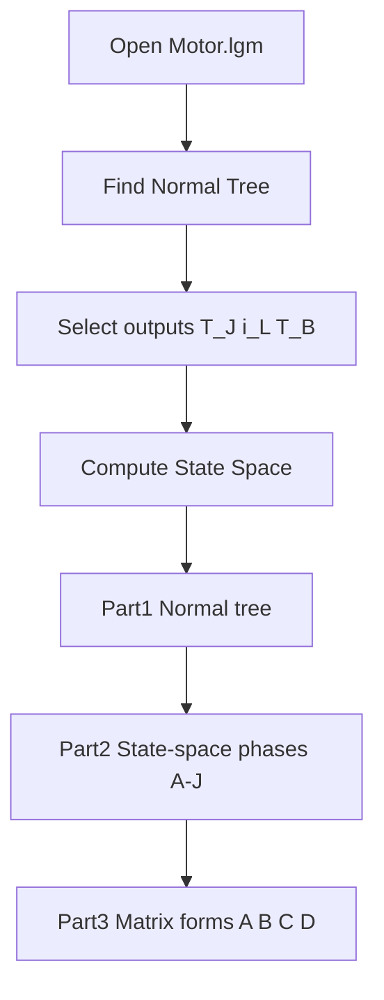
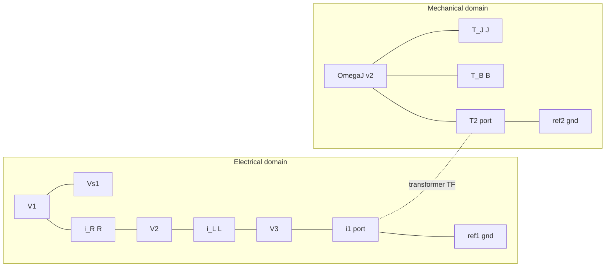
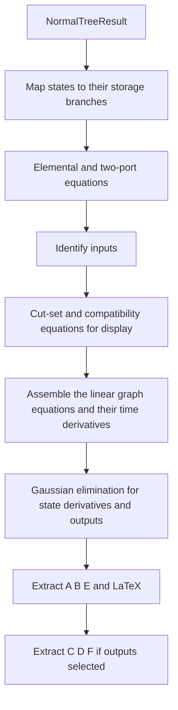

# Motor.lgm: End-to-End Analysis Walkthrough

This document is the **GitHub / developer reference** (with links into the source tree). The in-app guide under **Help → Guides** uses a link-free copy: [`src/assets/guides/state_space_from_normal_tree.md`](../src/assets/guides/state_space_from_normal_tree.md).

This traces **what the current implementation computes** for [`Examples/Motor.lgm`](../Examples/Motor.lgm): find a normal tree, derive state equations, and assemble **A**, **B**, **C**, and **D** matrices. The goal is algorithmic transparency, not error diagnosis.

**References:** graph assembly — Altun, Balkan & Platin (2002) ([doi](https://doi.org/10.13140/RG.2.2.29940.96647)); symbolic elimination — Geddes, Czapor & Labahn (1992), *Algorithms for Computer Algebra*, Ch. 9 §9.2 ([Springer](https://link.springer.com/book/10.1007/b102438)). In-app: **Help → About**.

**Notation:** the example file names the transformer modulus **`TF`**. MIT textbook notation for the same back-EMF / torque constant often writes **`Ka`** — they play the same role in the equations below.

---

## Workflow in the app

1. **File → Open** [`Examples/Motor.lgm`](../Examples/Motor.lgm)
2. **Analysis → Find All Normal Trees** (`Ctrl+Shift+T`) — tree twigs highlight **green**, co-tree links **gray**
3. **Analyze → Output variables (C and D matrices)** — check **`T_J through`**, **`i_L through`**, **`T_B through`**
4. **Analyze → Compute State Space** (`Ctrl+Shift+E`) — results appear in the **State Space** dock

Optional CLI verification (after building):

```text
LGM --analyze Examples/Motor.lgm T_J i_L T_B
```

Prints `output_eq=…` and `output_matrix=…` per [`src/ui/main.cpp`](../src/ui/main.cpp).



---

## Motor.lgm graph inventory

Permanent-magnet DC motor: electrical side (`R`, `L`, voltage source `Vs1`), transformer (modulus **`TF`**), mechanical side (`J`, `B`).

### Topology



| Node | Across symbol | Domain |
|------|---------------|--------|
| Node 1 | `V1` | Electrical |
| Node 2 | `V2` | Electrical |
| v₁ (transformer) | `V3` | Electrical |
| v₂ (transformer) | `OmegaJ` | Rotational |
| ref₁, ref₂ | `0` (ground) | — |

**7 branches**, **6 nodes**, **2 connected components** (electrical island + mechanical island joined by the transformer) → spanning tree size **4 twigs**.

### Branch table

| Branch | Constant | Effective type | MST weight | Normal-tree role |
|--------|----------|----------------|------------|------------------|
| `Vs1` | — | active A | 1 | Tree twig → **input** |
| `T_J` | `J` | passive A | 2 | Tree twig → **state** `OmegaJ` |
| `i_R` | `R` | D | 3 | Tree twig |
| `T_B` | `B` | D | 3 | Co-tree link |
| `i_L` | `L` | T | 4 | Co-tree link → **state** `i_L` |
| `i1` | — | passive T (port) | 4 | Tree twig (transformer left port) |
| `T2` | — | passive T (port) | 4 | Co-tree link (transformer right port) |

Transformer modulus in the file: **`TF`** (Properties → Transformer 1).

---

## Part 1 — Normal tree algorithm

Implementation: [`src/model/normal_tree/`](../src/model/normal_tree/) (`enumerateNormalTrees`, `kruskalNormalTree`, `extractStateVariables`). Theory background: **Help → Guides → Multiple Normal Tree Finding** and [`src/assets/guides/multiple_normal_tree_finding.md`](../src/assets/guides/multiple_normal_tree_finding.md).

The normal-tree module emits **no debug logs**; only state-space derivation prints `[state_space] …` tags (see [Diagnostic log map](#diagnostic-log-map)).

### Step 1 — Branch weights

Every branch gets an integer weight from its element type ([`branchWeight`](../src/model/normal_tree/build.cpp)):

| Element type | Weight |
|--------------|--------|
| A-type active | 1 |
| A-type passive | 2 |
| D-type | 3 |
| T-type passive | 4 |
| T-type active | 5 |

A **normal tree** is a spanning tree with minimum total weight among all spanning trees (MIT priority rules).

### Step 2 — Two-port port assignment

For each transformer, exactly **one** port branch must be in the tree ([`collectTreesForPortAssignments`](../src/model/normal_tree/enumerate.cpp)):

| Choice | Effect on Motor |
|--------|-----------------|
| **`i1` in tree**, `T2` forbidden | Parallel user branches on the mechanical span (`T_J`, `T_B`) remain eligible as twigs |
| `T2` in tree, `i1` forbidden | `T_J` and `T_B` (parallel to `T2` on v₂–ref₂) are **forbidden** on that span → cannot place inertia `T_J` in the tree |

The implementation tries both assignments and keeps feasible trees. For Motor, **`i1` in tree** wins because it allows A-type inertia in the tree (higher `TreeScore.aPassive`).

### Step 3 — Kruskal seed tree

[`kruskalNormalTree`](../src/model/normal_tree/build.cpp) builds the initial minimum spanning tree:

1. **Force in** (always, in order):
   - Active A-type sources → `Vs1`
   - Transformer forced port → `i1`
2. **Greedy add** remaining edges by ascending weight (ties by branch serial id):
   - `T_J` (A, weight 2) — inertia on mechanical span
   - `T_J` vs `T_B`: same endpoints (v₂–ref₂); only one fits without a cycle → **A beats D** → `T_J` added, `T_B` stays co-tree
   - `i_R` (D, weight 3)
   - Remaining links (`i_L`, `T_B`, `T2`) are co-tree — tree already has 4 twigs

**Seed tree:** `{Vs1, i1, T_J, i_R}`

### Step 4 — Equivalent-branch replacement

From the seed, BFS enumerates alternate normal trees by swapping a co-tree **link** with a same-weight tree **twig** on the link's fundamental loop ([`enumerateTreesForPortAssignment`](../src/model/normal_tree/enumerate.cpp)).

For Motor, no equal-weight swap produces another valid tree (e.g. swapping `i_R`↔`i_L` changes weight 3↔4; swapping `i1`↔`T2` violates the transformer one-port rule). Enumeration typically yields **one** tree.

### Step 5 — Scoring and validation

Each candidate is ranked by [`TreeScore::betterThan`](../src/model/normal_tree/build.cpp) (lower conflict count first, then more A-type and D-type in tree, fewer T-type in tree). Equal scores fall back to the twigs' serial ids, so the first tree never depends on memory layout. Only trees that tie the best score are kept. [`validateManualNormalTree`](../src/model/normal_tree/normal_tree.cpp) checks:

- All active A-type sources in tree (no cycle); no active T-type source in tree
- Transformer: exactly one port in tree; gyrator: zero or both
- Zero **same-span conflicts** for **transformers** (transformer port branch + parallel user branch both in tree on the same span); gyrators are not scored by this rule
- Connected spanning tree of correct size
- **Normal:** for the tree's own two-port assignment, as many passive A-type and as few passive T-type twigs as the greedy (Kruskal) tree. The greedy tree is optimal for both counts at once, so a manual selection that misses either is rejected.

[`computeNormalTree`](../src/model/normal_tree/normal_tree.cpp) returns the best tree from enumeration (`all.trees.front()` after sort).

### Step 6 — State variable extraction

[`extractStateVariables`](../src/model/normal_tree/enumerate.cpp) applies the MIT rule and nothing else:

- Passive branch **in tree**, type **A** → its across variable (`OmegaJ` from `T_J` via node v₂)
- Passive branch **in co-tree**, type **T** → its through variable (`i_L`)

Sources and two-port port branches never carry a state. Dependent storage — A-type links and T-type twigs, such as an inertia rigidly coupled to another one through a transformer — is already excluded by the tree, so no state is dropped afterwards and the result does not depend on how nodes are named. Each state records its storage branch for Part 2.

### Normal tree result (Motor)

| Field | Value |
|-------|-------|
| **Tree twigs (4)** | `Vs1`, `i1`, `T_J`, `i_R` |
| **Co-tree links (3)** | `i_L`, `T_B`, `T2` |
| **State variables** | `OmegaJ` (across), `i_L` (through) |
| **Input** (identified in Part 2) | `Vs1` |

**UI entry:** [`GraphScene::findNormalTree`](../src/canvas/scene/scene_normal_tree.cpp) → [`enumerateNormalTrees`](../src/model/normal_tree/enumerate.cpp).

---

## Branch types (MIT linear graph)

Passive branch behavior is classified as **A**, **T**, or **D** ([`elemental_equation/`](../src/model/elemental_equation/)). Constants infer type when the branch is still at default A-type (e.g. `R`→D, `L`→T, `J`→A).

| Type | Physical role | Elemental equation (generic) | State when… |
|------|---------------|------------------------------|-------------|
| **A** | Inertia, capacitance | `f = k·ẋ` | **In tree** → across variable is a state |
| **T** | Inductance, compliance | `Δe = k·ẋ_flow` | **In co-tree (link)** → through variable is a state |
| **D** | Resistance, damping | `f = k·e` (algebraic) | Never a state |

Active sources: **A-type in tree** → effort input; **T-type in co-tree** → flow input.

Two-port transformers add elemental constraints on port across and through variables (modulus `TF` in Motor.lgm).

---

## Part 2 — State-space derivation (phases A–H)

After a normal tree is committed, [`computeStateSpaceImpl`](../src/model/state_space/state_space.cpp) derives the state-space model. Entry: [`GraphScene::computeStateSpaceRep`](../src/canvas/scene/scene_normal_tree.cpp) → [`lg::computeStateSpace`](../src/model/state_space/state_space.cpp).



Each phase below lists **what**, **where in code**, and **Motor.lgm** log output. Logs are emitted by [`ss::ssLog`](../src/model/state_space_sym.cpp) to Qt debug output (`[state_space] …`) and mirrored to **stderr** when the app is run from a terminal ([`app_log.cpp`](../src/ui/app_log.cpp)).

### Phase A — Validate and map states

**Where:** [`StateSpaceContext::initStates`](../src/model/state_space/state_space_context.cpp). Each normal-tree state already carries its storage branch.

**Motor.lgm:** `OmegaJ ↔ T_J`, `i_L ↔ i_L`.

```
[state_space] begin - states=[OmegaJ, i_L] tree_branches=4
```

---

### Phase B — Elemental equations

**What:** Constitutive laws using [`branchNodeAcrossExpr`](../src/model/elemental_equation/symbols.cpp) — node-across differences from [`branchAcrossVariableText`](../src/model/elemental_equation/naming.cpp) — for every passive branch, plus the two-port laws.

**Where:** passive branch loop (`build_elementals`), then two-port elementals (`two_port_elementals`) in [`state_space_constraints.cpp`](../src/model/state_space/state_space_constraints.cpp).

**Motor.lgm** — human-readable (`elemental_text`):

```
T_J = J*OmegaJ_dot; T_B = B*OmegaJ; V2 - V3 = L*i_L_dot; i_R = (V1 - V2)/R; V3 = TF*OmegaJ; i1 = -T2/TF
```

Symbolic form (`0 = …`):

```
0 = T_J - J*OmegaJ_dot
0 = T_B - B*OmegaJ
0 = i_L_dot - V2/L + V3/L
0 = i_R - V1/R + V2/R
0 = V3 - TF*OmegaJ
0 = i1 + T2/TF
```

---

### Phase C — Inputs

**Where:** loop over active branches after elementals; logs `inputs`.

A-type active branch **in tree** → effort input. T-type active branch **in co-tree** → flow input.

**Motor.lgm:** `Vs1`.

---

### Phase D — Continuity and compatibility (display)

**Continuity:** for each twig, its fundamental cut-set equation solved for the twig flow. Every branch crossing the cut counts, port bonds included.

**Compatibility:** one equation per active A-type source in the tree, with the convention every branch uses, `u = v_from − v_to`:

- source node → ground: `v_from = u`
- ground → source node: `v_to = −u`
- floating source: `v_from = u + v_to`

These lists are shown in the UI (`continuity`, `compatibility_eqs` logs). The derivation in Phase E works on the full graph equations directly, so nothing here filters or orders it.

**Motor.lgm:**

```
continuity        i_Vs1 = -i_L; i1 = i_L; T_J = -(T2 + T_B); i_R = i_L
compatibility     V1 = Vs1
```

---

### Phase E — Assemble the linear system

**Where:** [`ssDeriveStateDots`](../src/model/state_space/state_space_states.cpp).

**Unknowns:** every node across variable, every branch through variable, and the time derivative of each. **Knowns:** the states `x`, the inputs `u` and their derivatives `u̇`. Element constants and moduli are parameters.

**Equations:**

1. KCL at every node, reference nodes included. Port branches are ordinary branches, so cascaded and stacked two-ports need no special case.
2. Each active A-type source: `v_from − v_to = u`.
3. D-type elementals and two-port laws (Phase B).
4. State definitions: `x = v_from − v_to` of its A-type twig, or `x = f` of its T-type link.
5. The time derivative of every equation in 1–4 — they hold at every instant.
6. A-type and T-type elementals (`f = C·v̇`, `ḟ = v/L`, …).

Level 5 is what couples **dependent storage**. An A-type link's flow is its constant times the derivative of an across difference that states and inputs already fix (`C4` in Electrical, `M_1` and `I_1` in TransformerCascade). A T-type twig's across is its constant times the derivative of a flow that states and inputs already fix (`L7` in Electrical). This is also where input derivatives, and so the **E** matrix, come from.

---

### Phase F — Solve for state derivatives and outputs

**Where:** [`solveLinearTargets`](../src/model/state_space_sym.cpp) — Gaussian elimination with back substitution (Geddes, Czapor & Labahn, 1992, *Algorithms for Computer Algebra*, Ch. 9 §9.2).

1. Pivot on non-target unknowns first, preferring numeric pivots in short equations; then on the targets (`x_dot` for every state, and every selected output).
2. Coefficients are tested as rational functions ([`isIdenticallyZero`](../src/model/state_space_sym.cpp)), so `a/(a+b) + b/(a+b) − 1` counts as zero.
3. A leftover equation with no unknowns that is not identically zero means the sources or the chosen states are not independent → error. A target that still depends on a free unknown is *not determined* → error naming it.
4. Each result is collected as `Σ coefficient · (x, u, u̇)` with each coefficient reduced to one fraction.

**Motor.lgm** (outputs `T_J`, `i_L`, `T_B` selected):

```
[state_space] solve - equations=28 unknowns=20 targets=4
OmegaJ_dot = -B*OmegaJ/J + TF*i_L/J
i_L_dot    = Vs1/L - R*i_L/L - TF*OmegaJ/L
```

---

### Phase G — State matrix form

**Where:** [`ssAssembleMatrix`](../src/model/state_space/state_space_matrix.cpp) — `state_equation`, `matrix_form`.

Builds `stateEquations` and LaTeX `ẋ = A x + B u [+ E u̇]`.

**Motor.lgm** — state order 2, `status: Ok`. State vector **x** = `[OmegaJ; i_L]`, input **u** = `Vs1`:

```
A = [ -B/J    TF/J  ]
    [ -TF/L   -R/L  ]

B = [ 0   ]
    [ 1/L ]

E = 0   (no input-derivative feedthrough)
```

(Textbook eq. (69) in [`TwoPortsBasics.txt`](TwoPortsBasics.txt), with `Ka` → `TF`.)

---

### Phase H — Output equations (C, D and F matrices)

**Where:** [`ssAssembleOutputs`](../src/model/state_space/state_space_matrix.cpp) — runs when the user selects **output variables** in the **Analyze** dock.

Selected outputs are extra targets of the Phase F solve, so **C**, **D** and **F** are consistent with **A**, **B** and **E** by construction. Any node across, branch through or branch across symbol can be selected; a selected state or input passes straight through.

For this walkthrough, select the textbook motor outputs **`T_J`**, **`i_L`**, **`T_B`** ([`TwoPortsBasics.txt`](TwoPortsBasics.txt) eq. (70–72)):

| Output | UI label | Result | C row `[OmegaJ, i_L]` | D |
|--------|----------|--------|------------------------|---|
| `T_J` | T_J through | `-B·OmegaJ + TF·i_L` | `[-B, TF]` | `0` |
| `i_L` | i_L through | `i_L` | `[0, 1]` | `0` |
| `T_B` | T_B through | `B·OmegaJ` | `[B, 0]` | `0` |

**F** (input-derivative feedthrough) is zero here and omitted from the LaTeX. If no outputs are selected, Phase H is skipped and the **State Space** dock shows only the state matrix.

---

## Part 3 — Result summary

### End-to-end for Motor.lgm

| Step | Result |
|------|--------|
| Normal tree | Twigs `{Vs1, i1, T_J, i_R}`; states `{OmegaJ, i_L}` |
| Input | `Vs1` |
| State equations | Standard DC-motor dynamics coupled through `TF`, `J`, `L`, `R`, `B` |
| **A**, **B** | 2×2 **A**, 2×1 **B** as in Phase G; **E** = 0 |
| **C**, **D** (textbook outputs) | 3×2 **C**, 3×1 **D** = 0 as in Phase H |

### Constraint chain (quick reference)

1. **Elementals** tie branches to node efforts (`V1−V2`, `V2−V3`, `OmegaJ`, …) and two-port laws.
2. **KCL** at every node and **source** equations (`V1 = Vs1`) close the graph.
3. **State definitions** tie `OmegaJ` and `i_L` to their branches.
4. All algebraic equations are also differentiated once, coupling dependent storage.
5. One Gaussian elimination yields **A**, **B**, **E** and, for selected outputs, **C**, **D**, **F**.

---

## Diagnostic log map

Run **Analyze → Compute State Space** (or `Ctrl+Shift+E`) from a terminal, or set `QT_LOGGING_RULES=*.debug=true`. Tags are printed as `[state_space] <tag> - <detail>`. On all platforms, every log line is also mirrored to **stderr** via [`app_log.cpp`](../src/ui/app_log.cpp) — useful on Windows where the GUI has no console.

| Log tag | Phase | Meaning |
|---------|-------|---------|
| `begin` | A | States and tree size |
| `build_elementals` / `two_port_elementals` | B | Elemental construction |
| `inputs` | C | Input symbols |
| `continuity_cuts` / `compatibility` | D | Display equation construction |
| `elemental_text` / `continuity` / `compatibility_eqs` | B–D | Display equation lists |
| `solve` | E–F | Equation, unknown and target counts |
| `state_equation` | G | Final scalar state equations |
| `matrix_form` | G | LaTeX state matrix `ẋ = A x + B u [+ E u̇]` |
| `output_equation` | H | Scalar output equation per selected variable |
| `output_matrix_form` | H | LaTeX output matrix `y = C x + D u [+ F u̇]` |
| `error` | any | Why the derivation stopped |

Normal-tree search emits **no** debug tags.

---

## Result fields

| Field | Content |
|-------|---------|
| `elementalEquations` | Node-across constitutive laws (Phase B) |
| `continuityEquations` | Fundamental cut-set equation of each twig (display) |
| `compatibilityEquations` | Active A-type node bindings only |
| `stateEquations` | Final `symbol_dot = …` |
| `matrixForm` | LaTeX `ẋ = A x + B u [+ E u̇]` |
| `outputs` / `outputLabels` | Selected output symbols and display labels (Phase H) |
| `outputEquations` | Final `y_i = …` scalar equations |
| `outputMatrixForm` | LaTeX `y = C x + D u [+ F u̇]` |

---

## References

| Topic | Citation |
|-------|----------|
| Normal tree, elementals, continuity, compatibility | Altun, K.; Balkan, R. T.; & Platin, B. E. (2002). *Extraction of state variable representations of dynamic systems employing linear graph theory.* [doi:10.13140/RG.2.2.29940.96647](https://doi.org/10.13140/RG.2.2.29940.96647) |
| Symbolic elimination (Phase F) | Geddes, K. O.; Czapor, S. R.; & Labahn, G. (1992). *Algorithms for Computer Algebra*, Ch. 9 §9.2 *Linear Equations and Gaussian Elimination*. Kluwer. [Springer](https://link.springer.com/book/10.1007/b102438) |

Full bibliography: [publication/literature_review.md](publication/literature_review.md).

---

## Source file index

| File | Role |
|------|------|
| [`src/model/normal_tree/`](../src/model/normal_tree/) | Normal tree search, scoring, state-variable selection |
| [`src/model/state_space/state_space.cpp`](../src/model/state_space/state_space.cpp) | Main orchestration (`computeStateSpaceImpl`) |
| [`src/model/state_space/state_space_constraints.cpp`](../src/model/state_space/state_space_constraints.cpp) | Elementals, continuity, compatibility |
| [`src/model/state_space/state_space_states.cpp`](../src/model/state_space/state_space_states.cpp) | Linear-system assembly; solve for state derivatives and outputs |
| [`src/model/state_space_graph.cpp`](../src/model/state_space_graph.cpp) | Cut-sets, output variable choices |
| [`src/model/elemental_equation/`](../src/model/elemental_equation/) | `branchNodeAcrossExpr`, symbols, elemental and two-port laws, port-span helpers for tree scoring |
| [`src/model/state_space_sym.cpp`](../src/model/state_space_sym.cpp) | `solveLinearTargets` (Gaussian elimination, Geddes et al., 1992, Ch. 9 §9.2), rational zero test, `ssLog` |
| [`src/model/state_space/state_space_matrix.cpp`](../src/model/state_space/state_space_matrix.cpp) | State matrix (A, B, E) and output matrix (C, D, F) assembly |
| [`src/model/state_space_latex.cpp`](../src/model/state_space_latex.cpp) | LaTeX matrix formatting |
| [`src/canvas/scene/scene_normal_tree.cpp`](../src/canvas/scene/scene_normal_tree.cpp) | UI: find normal tree, saved trees, compute state space |

</tool_call>