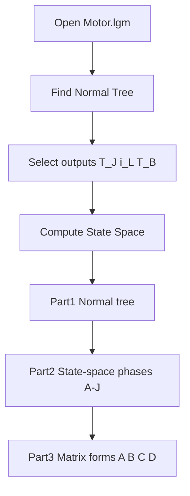
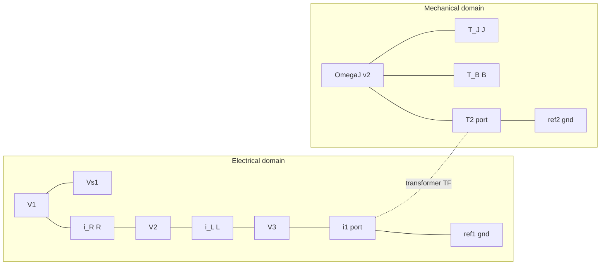
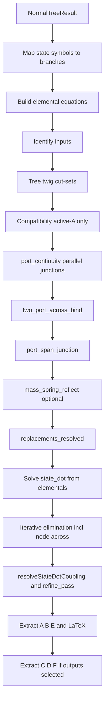

# Motor.lgm: End-to-End Analysis Walkthrough

This document is the **GitHub / developer reference** (with links into the source tree). The in-app guide under **Help → Guides** uses a link-free copy: [`src/assets/guides/state_space_from_normal_tree.md`](../src/assets/guides/state_space_from_normal_tree.md).

This traces **what the current implementation computes** for [`Examples/Motor.lgm`](../Examples/Motor.lgm): find a normal tree, derive state equations, and assemble **A**, **B**, **C**, and **D** matrices. The goal is algorithmic transparency, not error diagnosis.

**Notation:** the example file names the transformer modulus **`TF`**. MIT textbook notation for the same back-EMF / torque constant often writes **`Ka`** — they play the same role in the equations below.

---

## Workflow in the app

1. **File → Open** [`Examples/Motor.lgm`](../Examples/Motor.lgm)
2. **Analyze → Find Normal Tree** (`Ctrl+Shift+T`) — tree twigs highlight **green**, co-tree links **gray**
3. **Analyze → Output variables (C and D matrices)** — check **`T_J through`**, **`i_L through`**, **`T_B through`**
4. **Analyze → Compute State Space** (`Ctrl+Shift+S`) — results appear in the **State Space** dock

Optional CLI verification (after building):

```text
LGM --analyze Examples/Motor.lgm T_J i_L T_B
```

Prints `output_eq=…` and `output_matrix=…` per [`src/ui/main.cpp`](../src/ui/main.cpp).



---

## Motor.lgm graph inventory

Permanent-magnet DC motor: electrical side (`R`, `L`, voltage source `Vs1`), transformer (modulus **`TF`**), mechanical side (`J`, `B`).

### Topology



| Node | Across symbol | Domain |
|------|---------------|--------|
| Node 1 | `V1` | Electrical |
| Node 2 | `V2` | Electrical |
| v₁ (transformer) | `V3` | Electrical |
| v₂ (transformer) | `OmegaJ` | Rotational |
| ref₁, ref₂ | `0` (ground) | — |

**7 branches**, **6 nodes**, **2 connected components** (electrical island + mechanical island joined by the transformer) → spanning tree size **4 twigs**.

### Branch table

| Branch | Constant | Effective type | MST weight | Normal-tree role |
|--------|----------|----------------|------------|------------------|
| `Vs1` | — | active A | 1 | Tree twig → **input** |
| `T_J` | `J` | passive A | 2 | Tree twig → **state** `OmegaJ` |
| `i_R` | `R` | D | 3 | Tree twig |
| `T_B` | `B` | D | 3 | Co-tree link |
| `i_L` | `L` | T | 4 | Co-tree link → **state** `i_L` |
| `i1` | — | passive T (port) | 4 | Tree twig (transformer left port) |
| `T2` | — | passive T (port) | 4 | Co-tree link (transformer right port) |

Transformer modulus in the file: **`TF`** (Properties → Transformer 1).

---

## Part 1 — Normal tree algorithm

Implementation: [`src/model/normal_tree/`](../src/model/normal_tree/) (`enumerateNormalTrees`, `kruskalNormalTree`, `extractStateVariables`). Theory background: **Help → Guides → Multiple Normal Tree Finding** and [`src/assets/guides/multiple_normal_tree_finding.md`](../src/assets/guides/multiple_normal_tree_finding.md).

The normal-tree module emits **no debug logs**; only state-space derivation prints `[state_space] …` tags (see [Diagnostic log map](#diagnostic-log-map)).

### Step 1 — Branch weights

Every branch gets an integer weight from its element type ([`branchWeight`](../src/model/normal_tree/build.cpp)):

| Element type | Weight |
|--------------|--------|
| A-type active | 1 |
| A-type passive | 2 |
| D-type | 3 |
| T-type passive | 4 |
| T-type active | 5 |

A **normal tree** is a spanning tree with minimum total weight among all spanning trees (MIT priority rules).

### Step 2 — Two-port port assignment

For each transformer, exactly **one** port branch must be in the tree ([`collectTreesForPortAssignments`](../src/model/normal_tree/enumerate.cpp)):

| Choice | Effect on Motor |
|--------|-----------------|
| **`i1` in tree**, `T2` forbidden | Parallel user branches on the mechanical span (`T_J`, `T_B`) remain eligible as twigs |
| `T2` in tree, `i1` forbidden | `T_J` and `T_B` (parallel to `T2` on v₂–ref₂) are **forbidden** on that span → cannot place inertia `T_J` in the tree |

The implementation tries both assignments and keeps feasible trees. For Motor, **`i1` in tree** wins because it allows A-type inertia in the tree (higher `TreeScore.aPassive`).

### Step 3 — Kruskal seed tree

[`kruskalNormalTree`](../src/model/normal_tree/build.cpp) builds the initial minimum spanning tree:

1. **Force in** (always, in order):
   - Active A-type sources → `Vs1`
   - Transformer forced port → `i1`
2. **Greedy add** remaining edges by ascending weight (ties by branch pointer):
   - `T_J` (A, weight 2) — inertia on mechanical span
   - `T_J` vs `T_B`: same endpoints (v₂–ref₂); only one fits without a cycle → **A beats D** → `T_J` added, `T_B` stays co-tree
   - `i_R` (D, weight 3)
   - Remaining links (`i_L`, `T_B`, `T2`) are co-tree — tree already has 4 twigs

**Seed tree:** `{Vs1, i1, T_J, i_R}`

### Step 4 — Equivalent-branch replacement

From the seed, BFS enumerates alternate normal trees by swapping a co-tree **link** with a same-weight tree **twig** on the link's fundamental loop ([`enumerateTreesForPortAssignment`](../src/model/normal_tree/enumerate.cpp)).

For Motor, no equal-weight swap produces another valid tree (e.g. swapping `i_R`↔`i_L` changes weight 3↔4; swapping `i1`↔`T2` violates the transformer one-port rule). Enumeration typically yields **one** tree.

### Step 5 — Scoring and validation

Each candidate is ranked by [`TreeScore::betterThan`](../src/model/normal_tree/build.cpp) (lower conflict count first, then more A-type and D-type in tree, fewer T-type in tree). [`validateManualNormalTree`](../src/model/normal_tree/normal_tree.cpp) checks:

- All active A-type sources in tree (no cycle)
- Transformer: exactly one port in tree
- Zero **same-span conflicts** (port branch + parallel user branch both in tree)
- Connected spanning tree of correct size

[`computeNormalTree`](../src/model/normal_tree/normal_tree.cpp) returns the best tree from enumeration (`all.trees.front()` after sort).

### Step 6 — State variable extraction

[`extractStateVariables`](../src/model/normal_tree/enumerate.cpp) applies MIT rules:

**Across states (tree twigs):**

- Passive branch in tree, effective type **A** → across symbol (`OmegaJ` from `T_J` via node v₂)
- Port-span storage (`T_J` parallel to transformer port `T2`) → across symbol

**Through states (co-tree links):**

- Passive branch not in tree, effective type **T** → through symbol (`i_L`)

**Rotational inertia cleanup** (no mass `M` in tree): drop stray `v1`; keep the tree inertia across (`OmegaJ`); drop other `Omega*` symbols.

### Normal tree result (Motor)

| Field | Value |
|-------|-------|
| **Tree twigs (4)** | `Vs1`, `i1`, `T_J`, `i_R` |
| **Co-tree links (3)** | `i_L`, `T_B`, `T2` |
| **State variables** | `OmegaJ` (across), `i_L` (through) |
| **Input** (identified in Part 2) | `Vs1` |

**UI entry:** [`GraphScene::findNormalTree`](../src/canvas/scene/scene_normal_tree.cpp) → [`enumerateNormalTrees`](../src/model/normal_tree/enumerate.cpp).

---

## Branch types (MIT linear graph)

Passive branch behavior is classified as **A**, **T**, or **D** ([`elemental_equation/`](../src/model/elemental_equation/)). Constants infer type when the branch is still at default A-type (e.g. `R`→D, `L`→T, `J`→A).

| Type | Physical role | Elemental equation (generic) | State when… |
|------|---------------|------------------------------|-------------|
| **A** | Inertia, capacitance | `f = k·ẋ` | **In tree** → across variable is a state |
| **T** | Inductance, compliance | `Δe = k·ẋ_flow` | **In co-tree (link)** → through variable is a state |
| **D** | Resistance, damping | `f = k·e` (algebraic) | Never a state |

Active sources: **A-type in tree** → effort input; **T-type in co-tree** → flow input.

Two-port transformers add elemental constraints on port across and through variables (modulus `TF` in Motor.lgm).

---

## Part 2 — State-space derivation (phases A–J)

After a normal tree is committed, [`computeStateSpaceImpl`](../src/model/state_space/state_space.cpp) derives the state-space model. Entry: [`GraphScene::computeStateSpaceRep`](../src/canvas/scene/scene_normal_tree.cpp) → [`lg::computeStateSpace`](../src/model/state_space/state_space.cpp).



**Important:** [`recordConstraint`](../src/model/state_space/state_space_constraints.cpp) never overwrites a symbol already set by continuity or compatibility. Two-port **flow** relations (`i1 = −T2/TF`) are **not** duplicated into `replacements` — they remain in the elemental set only, avoiding conflicts such as overwriting `i1 = i_L`.

Each phase below lists **what**, **where in code**, and **Motor.lgm** log output. Logs are emitted by [`ss::ssLog`](../src/model/state_space_sym.cpp) to Qt debug output (`[state_space] …`).

### Phase A — Validate and map states

**Where:** start of `computeStateSpaceImpl` — status checks, then state→branch mapping.

Maps each `tree.stateVariables` entry to its storage branch via [`ss::isStateBranch`](../src/model/state_space_graph.cpp) / [`ss::storageStateSymbol`](../src/model/state_space_graph.cpp).

**Motor.lgm:** `OmegaJ ↔ T_J`, `i_L ↔ i_L`.

```
[state_space] begin - states=[OmegaJ (T_J), i_L (i_L)] tree_branches=4
```

---

### Phase B — Elemental equations

**What:** Constitutive laws using [`branchNodeAcrossExpr`](../src/model/elemental_equation/symbols.cpp) — node-across differences from [`branchAcrossVariableText`](../src/model/elemental_equation/naming.cpp), not synthetic `*_a` symbols.

**Where:** passive branch loop (`build_elementals`), then two-port elementals (`two_port_elementals`).

**Motor.lgm** — human-readable (`elemental_text`):

```
T_J = J*OmegaJ_dot; T_B = B*OmegaJ; V2 - V3 = L*i_L_dot; i_R = (V1 - V2)/R; V3 = TF*OmegaJ; i1 = -T2/TF
```

Unreduced symbolic (`elemental`):

```
0 = T_J - J*OmegaJ_dot
0 = T_B - B*OmegaJ
0 = i_L_dot - V2/L + V3/L
0 = i_R - V1/R + V2/R
0 = V3 - TF*OmegaJ
0 = i1 + T2/TF
```

---

### Phase C — Inputs

**Where:** loop over active branches after elementals; logs `inputs`.

A-type active branch **in tree** → effort input. T-type active branch **in co-tree** → flow input.

**Motor.lgm:** `Vs1`.

---

### Phase D — Continuity (cut-sets and port parallel)

**What:** Flow replacements from (1) **tree twig cut-sets** and (2) **port-span parallel junctions** (`port_continuity`).

**Where:** `continuity_cuts` / `continuity_twig` loop, then `port_continuity`; aggregated list logged as `continuity`.

**Tree twig cuts** (unless skipped):

- Active A-type source twigs are **no longer skipped** — a cut-set is taken for the source's own through-flow (e.g. `i_Vs1 = -i_L`). This exposes the source current for floating-source and multi-input graphs; on Motor the source flow is unused downstream but still recorded.
- Skip port-span user branches via [`skipTwigFlowContinuity`](../src/model/elemental_equation/topology.cpp) — e.g. `T_J` on the transformer mechanical span uses the port-span junction instead of a cut-set on the twig.

For each remaining twig: partition graph at a cut, sum signed through-flows, solve for the twig flow → `recordReplacement` into `continuityEquations`.

**Port-span parallel junction:** for a co-tree port with user branches on the same nodes (e.g. `T_B`, `T_J` parallel to port `T2`):

```
port_flow = −(sum of parallel branch flows)
```

**Motor.lgm** — logged at `[state_space] continuity` (after cut-sets + port parallel):

```
i_Vs1 = -i_L
i1 = i_L
i_R = i_L
T2 = -(T_B + T_J)
```

---

### Phase E — Compatibility (active A-type only)

**What:** One equation per active A-type source in the tree, keyed on which endpoints are ground:

- Source to ground → non-reference node across = input symbol (`V1 = Vs1`).
- **Floating source** between two non-ground nodes (e.g. `Ps1` across `P1`–`P6`) → `v_from = u + v_to`, i.e. the input equals the across difference `u = v_from − v_to`.

**Where:** loop after cut-sets, before `port_continuity`; results in `compatibilityEquations`, logged as `compatibility_eqs`.

No KVL loop solves on co-tree links. Node across variables (`V2`, `V3`, …) stay as symbols until Phase H elimination.

**Motor.lgm** (source `Vs1` grounded at `ref1`):

```
V1 = Vs1
```

---

### Phase F — Two-port across, port-span inertia, mass–spring reflect

**Where:** `two_port_across_bind` (with cascade propagation passes), `port_span_junction`, `mass_spring_reflect`.

| Rule | Recorded as | Notes |
|------|-------------|-------|
| Transformer **across** | `V3 = TF*OmegaJ` via `recordConstraint` | Flow relations **not** duplicated here |
| Port-span A-type storage (`T_J`) | `T_J = -T_B + TF*i_L` → `continuityEquations` | Uses reflected port current; runs in `port_span_junction` |
| `recordConstraint` | Skips if symbol already in `replacements` | Protects `i1 = i_L` from being overwritten by `i1 = -T2/TF` |
| Mass + co-tree compliance | `mass_spring_reflect` | Optional; not used on Motor.lgm |

Two-port **flows** (`i1 = −T2/TF`) remain **only** in elementals (Phase B). Putting them into `replacements` on top of continuity caused circular resolves (`T_J = T_J`) and corrupted `state_dot` elimination.

After all constraint phases, `replacements_resolved` logs the chained map (branch-across synthetic symbols `R_across`, `L_across` and the source flow `i_Vs1` are included):

**Motor.lgm:**

```
R_across = -V2 + Vs1
L_across = V2 - TF*OmegaJ
T_J = -T_B + TF*i_L
V3 = TF*OmegaJ
T2 = -TF*i_L
V1 = Vs1
i1 = i_L
i_R = i_L
i_Vs1 = -i_L
```

---

### Phase G — Derive `state_dot`

**Where:** `substitute_elementals`, `match_state_dots`, `matched` / `state_dot_initial`.

1. `valueSubMap` / `subMap` from resolved `replacements`.
2. Log `elemental`, `reduced_elemental` (after `subMap`).
3. For each storage elemental, [`solveLinearFor`](../src/model/state_space_sym.cpp) on the **`valueSubMap`**-reduced form.

**Motor.lgm:**

| Stage | `OmegaJ_dot` | `i_L_dot` |
|-------|--------------|-----------|
| `reduced_elemental` (T_J row) | `0 = -T_B - J·OmegaJ_dot + TF·i_L` | — |
| `state_dot_initial` | `(−T_B + TF·i_L) / J` | `V2/L − TF·OmegaJ/L` |
| after elimination (Phase H) | `−B·OmegaJ/J + TF·i_L/J` | `Vs1/L − R·i_L/L − TF·OmegaJ/L` |

Elimination applies `T_B = B·OmegaJ` (algebraic) and substitutes `V2 = -R·i_L + Vs1` via the resistor elemental.

---

### Phase H — Symbol elimination and coupling

**Where:** [`state_space_eliminate.cpp`](../src/model/state_space_eliminate.cpp) — `eliminateBranchSymbolsInto`, `eliminateSymbolsInto`, `resolveStateDotCoupling`, `refine_pass`, `final_sub`.

Eliminates branch flows and **node across** symbols from `stateDots` using algebraics, constraint relations, and guarded substitution (`acceptStateDotSubstitution`). Coupling resolve may run twice; up to four refine passes follow.

**Coupled algebraic subsystem solve** ([`solveLinearSubsystem`](../src/model/state_space_sym.cpp), [`expandCoupledAlgebraicUnknowns`](../src/model/state_space_sym.cpp)): when leftover algebraic unknowns (node-across / branch flows) survive single-symbol elimination because they are *mutually* coupled — as in multi-input circuits where a node effort and a resistor current each depend on the other — the leftover set is expanded across relations that touch it and solved as one linear system (up to 4 passes, logged `subsystem_solve` / `subsystem_solved`).

A guard also blocks any elimination whose solved form would **recycle a state's own `_dot`** (e.g. `pump.lgm` `Q_L1`/`P1`), preventing a `Q_dot = f(Q_dot)` cycle.

**Motor.lgm** — after first elimination pass (`pre_coupling` / `state_dot`), `coupling` reports *all decoupled* (no subsystem solve needed):

```
OmegaJ_dot = -B*OmegaJ/J + TF*i_L/J
i_L_dot    = Vs1/L - R*i_L/L - TF*OmegaJ/L
```

Both depend only on `{OmegaJ, i_L, Vs1}` → validation passes.

---

### Phase I — State matrix form

**Where:** [`ssAssembleMatrix`](../src/model/state_space/state_space_matrix.cpp) — `state_equation`, `matrix_form`.

Builds `stateEquations` and LaTeX `ẋ = A x + B u [+ E u̇]`.

**Motor.lgm** — state order 2, `status: Ok`.

State vector **x** = `[OmegaJ; i_L]`, input **u** = `Vs1`:

```
OmegaJ_dot = -B/J * OmegaJ + TF/J * i_L
i_L_dot    = -TF/L * OmegaJ - R/L * i_L + 1/L * Vs1
```

Matrix form (textbook eq. (69) in [`TwoPortsBasics.txt`](TwoPortsBasics.txt), with `Ka` → `TF`):

```
A = [ -B/J    TF/J  ]
    [ -TF/L   -R/L  ]

B = [ 0   ]
    [ 1/L ]

E = 0   (no input-derivative feedthrough)
```

LaTeX in the **State Space** dock:

```
ẋ = A x + B u
```

---

### Phase J — Output equations (C and D matrices)

**Where:** [`ssAssembleOutputs`](../src/model/state_space/state_space_matrix.cpp) — runs after Phase I when the user selects **output variables** in the **Analyze** dock.

For this walkthrough, select textbook motor outputs: **`T_J`**, **`i_L`**, **`T_B`** (electromagnetic torque, armature current, viscous bearing torque — [`TwoPortsBasics.txt`](TwoPortsBasics.txt) eq. (70–72)).

#### How each output is derived

[`ssAssembleOutputs`](../src/model/state_space/state_space_matrix.cpp) processes each selected symbol:

1. **Seed** an expression — from resolved replacements, branch elementals, or constitutive relations ([`seedOutputExpr`](../src/model/state_space/state_space_matrix.cpp)).
2. **Filter** relations that would eliminate the output prematurely.
3. **Reduce** using the same elimination machinery as state-dot derivation (`ssReduceExpressions`, no coupling resolve).
4. **Substitute** dependent dots, values, and state dots.
5. **Verify** linearity in `{x, u, u̇}`.
6. **Extract** coefficients into **C**, **D**, and (if needed) **F** rows; log `output_equation` and `output_matrix_form`.

| Output | UI label | Seed source | After reduction | C row `[OmegaJ, i_L]` | D |
|--------|----------|-------------|-----------------|------------------------|---|
| `T_J` | T_J through | `T_J = -T_B + TF·i_L` + `T_B = B·OmegaJ` | `-B·OmegaJ + TF·i_L` | `[-B, TF]` | `0` |
| `i_L` | i_L through | continuity `i1 = i_L` / symbol | `i_L` | `[0, 1]` | `0` |
| `T_B` | T_B through | elemental `T_B = B·OmegaJ` | `B·OmegaJ` | `[B, 0]` | `0` |

Scalar output equations:

```
T_J = -B*OmegaJ + TF*i_L
i_L = i_L
T_B = B*OmegaJ
```

Output matrix form:

```
y = C x + D u

C = [ -B      TF ]
    [  0       1 ]
    [  B       0 ]

D = [ 0 ]
    [ 0 ]
    [ 0 ]

F = 0   (omitted from LaTeX when zero)
```

LaTeX in the **State Space** dock:

```
y = C x + D u
```

with **y** = `[T_J; i_L; T_B]`.

**Note:** selecting **state** outputs (`OmegaJ`, `i_L`) instead gives **C = I₂** and **D = 0** — identity observables. The textbook **`T_J`, `i_L`, `T_B`** set is the nontrivial **C** case used in motor dynamic studies.

If no outputs are selected, Phase J is skipped and the **State Space** dock shows only the state matrix.

---

## Part 3 — Result summary

### End-to-end for Motor.lgm

| Step | Result |
|------|--------|
| Normal tree | Twigs `{Vs1, i1, T_J, i_R}`; states `{OmegaJ, i_L}` |
| Input | `Vs1` |
| State equations | Standard DC-motor dynamics coupled through `TF`, `J`, `L`, `R`, `B` |
| **A**, **B** | 2×2 **A**, 2×1 **B** as in Phase I; **E** = 0 |
| **C**, **D** (textbook outputs) | 3×2 **C**, 3×1 **D** = 0 as in Phase J |

### Constraint chain (quick reference)

1. **Elementals** tie branches to node efforts (`V1−V2`, `V2−V3`, `OmegaJ`, …) and two-port laws.
2. **Continuity** sets `i_Vs1 = −i_L`, `i1 = i_L`, `i_R = i_L`, `T2 = −(T_B + T_J)`, and (port-span) `T_J = −T_B + TF·i_L`.
3. **Compatibility** sets `V1 = Vs1` only (grounded source; a floating source would set `v_from = u + v_to`).
4. **Two-port across** adds `V3 = TF·OmegaJ`; flows are **not** re-bound in `replacements`.
5. **State equations** → **A**, **B**.
6. **Output equations** for `T_J`, `i_L`, `T_B` → **C**, **D**.

---

## Diagnostic log map

Run **Analyze → Compute State Space** (or `Ctrl+Shift+S`) with Qt debug output enabled (e.g. run from a terminal, or set `QT_LOGGING_RULES=*.debug=true`). Tags are printed as `[state_space] <tag> - <detail>`.

| Log tag | Phase | Meaning |
|---------|-------|---------|
| `begin` | A | States and tree size |
| `build_elementals` / `two_port_elementals` | B | Elemental construction |
| `elemental_text` | B | Human-readable constitutive equations |
| `inputs` | C | Input symbols |
| `continuity_cuts` / `continuity_twig` | D | Per-twig cut-set progress |
| `port_continuity` | D | Port-span parallel junctions |
| `continuity` | D | Full `continuityEquations` list |
| `compatibility_eqs` | E | Active A-type node bindings |
| `two_port_across_bind` | F | Across-only two-port constraints |
| `port_span_junction` | F | Port-span A-type storage junctions |
| `mass_spring_reflect` | F | Mass/compliance reflection (if applicable) |
| `replacements` / `replacements_resolved` | F→G | Raw count and chained replacement map |
| `elemental` | G | Unreduced `0 = …` elementals |
| `reduced_elemental` | G | Elementals after `subMap` |
| `matched` | G | Storage elemental → `state_dot` solve |
| `state_dot_initial` | G | Right after solve, before elimination |
| `state_dot_after_value_sub` | H | After `valueSubMap` on `stateDots` |
| `pre_coupling` / `state_dot` | H | After first elimination pass |
| `coupling` | H | `resolveStateDotCoupling` progress |
| `subsystem_solve` / `subsystem_solved` | H | Coupled algebraic-unknown linear solve (multi-input) |
| `refine_pass` | H | Post-coupling refinement |
| `state_equation` | I | Final scalar state equations |
| `matrix_form` | I | LaTeX state matrix `ẋ = A x + B u [+ E u̇]` |
| `output_equation` | J | Scalar output equation per selected variable |
| `output_matrix_form` | J | LaTeX output matrix `y = C x + D u [+ F u̇]` |
| `ok` | I–J | Success and state order |

Normal-tree search emits **no** debug tags.

---

## Result fields

| Field | Content |
|-------|---------|
| `elementalEquations` | Node-across constitutive laws (Phase B) |
| `continuityEquations` | Flow replacements (cut-sets, port junctions, port-span inertia) |
| `compatibilityEquations` | Active A-type node bindings only |
| `stateEquations` | Final `symbol_dot = …` |
| `matrixForm` | LaTeX `ẋ = A x + B u [+ E u̇]` |
| `outputs` / `outputLabels` | Selected output symbols and display labels (Phase J) |
| `outputEquations` | Final `y_i = …` scalar equations |
| `outputMatrixForm` | LaTeX `y = C x + D u [+ F u̇]` |

---

## Source file index

| File | Role |
|------|------|
| [`src/model/normal_tree/`](../src/model/normal_tree/) | Normal tree search, scoring, state-variable selection |
| [`src/model/state_space/state_space.cpp`](../src/model/state_space/state_space.cpp) | Main orchestration (`computeStateSpaceImpl`) |
| [`src/model/state_space/state_space_constraints.cpp`](../src/model/state_space/state_space_constraints.cpp) | Elementals, continuity, compatibility |
| [`src/model/state_space/state_space_states.cpp`](../src/model/state_space/state_space_states.cpp) | State-dot derivation and elimination passes |
| [`src/model/state_space_graph.cpp`](../src/model/state_space_graph.cpp) | Cut-sets, state-branch helpers, output variable choices |
| [`src/model/elemental_equation/`](../src/model/elemental_equation/) | `branchNodeAcrossExpr`, symbols, port-span helpers |
| [`src/model/state_space_eliminate.cpp`](../src/model/state_space_eliminate.cpp) | Elimination and coupling resolve |
| [`src/model/state_space_sym.cpp`](../src/model/state_space_sym.cpp) | `resolveReplacements`, linear solve, `ssLog` |
| [`src/model/state_space/state_space_matrix.cpp`](../src/model/state_space/state_space_matrix.cpp) | State matrix (A, B, E) and output matrix (C, D, F) assembly |
| [`src/model/state_space_latex.cpp`](../src/model/state_space_latex.cpp) | LaTeX matrix formatting |
| [`src/canvas/scene/scene_normal_tree.cpp`](../src/canvas/scene/scene_normal_tree.cpp) | UI: find normal tree, compute state space |

</tool_call>