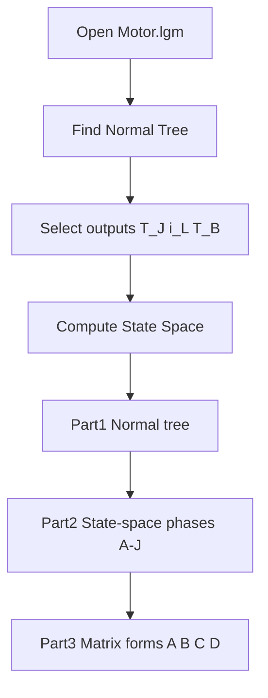
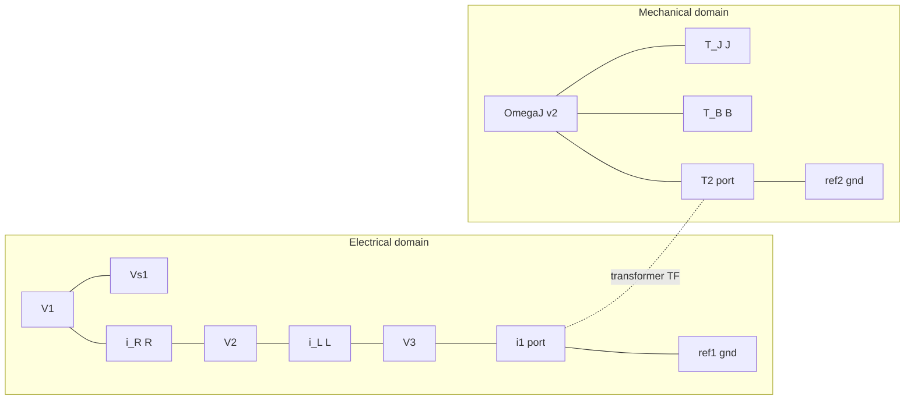
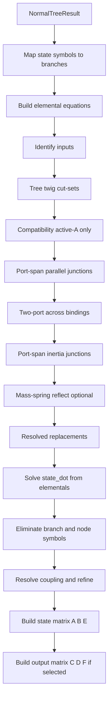

# Motor.lgm: End-to-End Analysis Walkthrough

What the app computes for **Examples/Motor.lgm**: find a normal tree, derive state equations, and assemble **A**, **B**, **C**, and **D** matrices. Algorithm walkthrough only — no source paths. For file-level references see `docs/state_space_from_normal_tree.md` in the repository. Citations: **Help → About** (Altun et al., 2002 — graph assembly; Geddes, Czapor & Labahn, 1992, Ch. 9 §9.2 — symbolic elimination).

**Notation:** the example file names the transformer modulus **`TF`**. MIT textbook notation for the same back-EMF / torque constant often writes **`Ka`** — they play the same role in the equations below.

---

## Workflow in the app

1. **File → Open** **Examples/Motor.lgm**
2. **Analyze → Find Normal Tree** (`Ctrl+Shift+T`) — tree twigs highlight **green**, co-tree links **gray**
3. **Analyze → Output variables (C and D matrices)** — check **`T_J through`**, **`i_L through`**, **`T_B through`**
4. **Analyze → Compute State Space** (`Ctrl+Shift+S`) — results appear in the **State Space** dock

Optional CLI verification (after building):

```text
LGM --analyze Examples/Motor.lgm T_J i_L T_B
```



---

## Motor.lgm graph inventory

Permanent-magnet DC motor: electrical side (`R`, `L`, voltage source `Vs1`), transformer (modulus **`TF`**), mechanical side (`J`, `B`).

### Topology



| Node | Across symbol | Domain |
|------|---------------|--------|
| Node 1 | `V1` | Electrical |
| Node 2 | `V2` | Electrical |
| v₁ (transformer) | `V3` | Electrical |
| v₂ (transformer) | `OmegaJ` | Rotational |
| ref₁, ref₂ | `0` (ground) | — |

**7 branches**, **6 nodes**, **2 connected components** (electrical island + mechanical island joined by the transformer) → spanning tree size **4 twigs**.

### Branch table

| Branch | Constant | Effective type | MST weight | Normal-tree role |
|--------|----------|----------------|------------|------------------|
| `Vs1` | — | active A | 1 | Tree twig → **input** |
| `T_J` | `J` | passive A | 2 | Tree twig → **state** `OmegaJ` |
| `i_R` | `R` | D | 3 | Tree twig |
| `T_B` | `B` | D | 3 | Co-tree link |
| `i_L` | `L` | T | 4 | Co-tree link → **state** `i_L` |
| `i1` | — | passive T (port) | 4 | Tree twig (transformer left port) |
| `T2` | — | passive T (port) | 4 | Co-tree link (transformer right port) |

Transformer modulus in the file: **`TF`** (Properties → Transformer 1).

---

## Part 1 — Normal tree algorithm

Theory background: **Help → Guides → Multiple Normal Tree Finding**.

The normal-tree step emits **no debug logs**; only state-space derivation prints `[state_space] …` tags.

### Step 1 — Branch weights

Every branch gets an integer weight from its element type:

| Element type | Weight |
|--------------|--------|
| A-type active | 1 |
| A-type passive | 2 |
| D-type | 3 |
| T-type passive | 4 |
| T-type active | 5 |

A **normal tree** is a spanning tree with minimum total weight among all spanning trees (MIT priority rules).

### Step 2 — Two-port port assignment

For each transformer, exactly **one** port branch must be in the tree:

| Choice | Effect on Motor |
|--------|-----------------|
| **`i1` in tree**, `T2` forbidden | Parallel user branches on the mechanical span (`T_J`, `T_B`) remain eligible as twigs |
| `T2` in tree, `i1` forbidden | `T_J` and `T_B` (parallel to `T2` on v₂–ref₂) are **forbidden** on that span → cannot place inertia `T_J` in the tree |

The app tries both assignments and keeps feasible trees. For Motor, **`i1` in tree** wins because it allows A-type inertia in the tree.

### Step 3 — Kruskal seed tree

The initial minimum spanning tree is built as follows:

1. **Force in** (always, in order):
   - Active A-type sources → `Vs1`
   - Transformer forced port → `i1`
2. **Greedy add** remaining edges by ascending weight:
   - `T_J` (A, weight 2) — inertia on mechanical span
   - `T_J` vs `T_B`: same endpoints (v₂–ref₂); only one fits without a cycle → **A beats D** → `T_J` added, `T_B` stays co-tree
   - `i_R` (D, weight 3)
   - Remaining links (`i_L`, `T_B`, `T2`) are co-tree — tree already has 4 twigs

**Seed tree:** `{Vs1, i1, T_J, i_R}`

### Step 4 — Equivalent-branch replacement

From the seed, the app enumerates alternate normal trees by swapping a co-tree **link** with a same-weight tree **twig** on the link's fundamental loop.

For Motor, no equal-weight swap produces another valid tree. Enumeration typically yields **one** tree.

### Step 5 — Scoring and validation

Each candidate is ranked (fewer same-span conflicts first, then more A-type and D-type in tree, fewer T-type in tree). Validation checks:

- All active A-type sources in tree (no cycle)
- Transformer: exactly one port in tree
- Zero **same-span conflicts** for **transformers** (transformer port branch + parallel user branch both in tree on the same span); gyrators are not scored by this rule
- Connected spanning tree of correct size

**Find Normal Tree** returns the best tree from enumeration.

### Step 6 — State variable extraction

MIT rules:

**Across states (tree twigs):**

- Passive branch in tree, effective type **A** → across symbol (`OmegaJ` from `T_J` via node v₂)
- Port-span storage (`T_J` parallel to transformer port `T2`) → across symbol

**Through states (co-tree links):**

- Passive branch not in tree, effective type **T** → through symbol (`i_L`)

**Rotational inertia cleanup** (no mass `M` in tree): drop stray `v1`; keep the tree inertia across (`OmegaJ`); drop other `Omega*` symbols.

### Normal tree result (Motor)

| Field | Value |
|-------|-------|
| **Tree twigs (4)** | `Vs1`, `i1`, `T_J`, `i_R` |
| **Co-tree links (3)** | `i_L`, `T_B`, `T2` |
| **State variables** | `OmegaJ` (across), `i_L` (through) |
| **Input** (identified in Part 2) | `Vs1` |

---

## Branch types (MIT linear graph)

| Type | Physical role | Elemental equation (generic) | State when… |
|------|---------------|------------------------------|-------------|
| **A** | Inertia, capacitance | `f = k·ẋ` | **In tree** → across variable is a state |
| **T** | Inductance, compliance | `Δe = k·ẋ_flow` | **In co-tree (link)** → through variable is a state |
| **D** | Resistance, damping | `f = k·e` (algebraic) | Never a state |

Element constants (`R`, `L`, `J`, …) can infer type when the branch is still default A-type.

Active sources: **A-type in tree** → effort input; **T-type in co-tree** → flow input.

Two-port transformers add across and through constraints (modulus `TF` in Motor.lgm).

---

## Part 2 — State-space derivation (phases A–J)

After a normal tree is committed, the app derives the state-space model.



**Important:** across bindings never overwrite continuity or compatibility. Two-port **flow** laws (`i1 = −T2/TF`) are **not** copied into the replacement map — that would overwrite cuts like `i1 = i_L`.

### Phase A — Validate and map states

Map each normal-tree state symbol to its storage branch.

**Motor:** `OmegaJ ↔ T_J`, `i_L ↔ i_L`.

---

### Phase B — Elemental equations

Constitutive laws in node-across form (not synthetic `*_a` symbols). Tree twigs on a port span: external non-storage branches are skipped unless they are **D-type** — dissipators in the tree on a port span still contribute elementals.

**Motor** — constitutive summary:

```
T_J = J*OmegaJ_dot; T_B = B*OmegaJ; V2 - V3 = L*i_L_dot; i_R = (V1 - V2)/R; V3 = TF*OmegaJ; i1 = -T2/TF
```

Symbolic form before substitution:

```
0 = T_J - J*OmegaJ_dot
0 = T_B - B*OmegaJ
0 = i_L_dot - V2/L + V3/L
0 = i_R - V1/R + V2/R
0 = V3 - TF*OmegaJ
0 = i1 + T2/TF
```

---

### Phase C — Inputs

A-type active branch **in tree** → effort input. T-type active **in co-tree** → flow input.

**Motor:** `Vs1`.

---

### Phase D — Continuity

**Tree twig cut-sets** (active A source twigs now also get a cut for their own through-flow; port-span twigs get a junction instead):

For each remaining twig: cut the graph, sum signed through-flows, solve for the twig flow.

**Port-span parallel junction** (co-tree port with parallel user branches):

```
port_flow = −(sum of parallel branch flows)
```

**Cascaded transformers (shared ref):** when co-tree port bonds share only a **reference node** but sit on **different spans**, continuity applies **KCL at the shared ground** — flows incident on that ref are summed, not treated as same-span parallels.

**D-type co-tree twig on port span:** before recording the port flow replacement, any **D-type tree twig** on the same span that was skipped for cut-set continuity may be solved from the junction equation and recorded first.

**Motor:**

```
i_Vs1 = -i_L
i1 = i_L
i_R = i_L
T2 = -(T_B + T_J)
```

The source flow `i_Vs1` is unused downstream here, but recording it lets floating-source and multi-input graphs solve.

---

### Phase E — Compatibility

One equation per active A-type source in the tree. Source to ground → driven node across = input symbol. **Floating source** between two non-ground nodes → `v_from = u + v_to` (the input equals the across difference `u = v_from − v_to`). No KVL on co-tree links.

**Motor** (`Vs1` grounded): `V1 = Vs1`.

---

### Phase F — Two-port across and port-span inertia

| Rule | Effect |
|------|--------|
| Transformer **across** | `V3 = TF*OmegaJ` |
| Port-span A storage (`T_J`) | `T_J = -T_B + TF*i_L` (uses reflected port current) |
| Existing replacements | Never overwritten by two-port flow aliases |

**Motor — resolved replacements** (`R_across`, `L_across` are branch-across synthetic symbols; `i_Vs1` is the source flow):

```
R_across = -V2 + Vs1
L_across = V2 - TF*OmegaJ
T_J = -T_B + TF*i_L
V3 = TF*OmegaJ
T2 = -TF*i_L
V1 = Vs1
i1 = i_L
i_R = i_L
i_Vs1 = -i_L
```

---

### Phase G — Derive `state_dot`

Substitute replacements into elementals; solve each storage elemental for its `state_dot`.

**Motor:**

| Stage | `OmegaJ_dot` | `i_L_dot` |
|-------|--------------|-----------|
| After T_J row reduction | `0 = -T_B - J·OmegaJ_dot + TF·i_L` | — |
| Initial solve | `(−T_B + TF·i_L) / J` | `V2/L − TF·OmegaJ/L` |
| After elimination | `−B·OmegaJ/J + TF·i_L/J` | `Vs1/L − R·i_L/L − TF·OmegaJ/L` |

---

### Phase H — Elimination and coupling

Eliminate branch flows and node across symbols. Resolve any coupled `state_dot` terms; refine until only states and inputs remain.

**Theory reference:** Geddes, Czapor & Labahn (1992), *Algorithms for Computer Algebra*, Ch. 9 §9.2 *Linear Equations and Gaussian Elimination* — iterative solve-and-substitute for single unknowns; Gaussian elimination with back substitution on coupled algebraic blocks. See **Help → About**.

When leftover algebraic unknowns are **mutually coupled** (common in multi-input circuits, where a node effort and a branch current each depend on the other), they are gathered and solved together as one linear subsystem. A guard blocks eliminations that would make a state depend on its own `_dot`. A second guard rejects eliminations that introduce **other states'** `x_dot` when the target state's own elemental already defines its dot.

**Motor — final** (no coupling; both decouple immediately):

```
OmegaJ_dot = -B*OmegaJ/J + TF*i_L/J
i_L_dot    = Vs1/L - R*i_L/L - TF*OmegaJ/L
```

---

### Phase I — State matrix form

Build scalar state equations and LaTeX `ẋ = A x + B u [+ E u̇]` in the **State Space** dock.

**Motor** — state order 2, status OK.

State vector **x** = `[OmegaJ; i_L]`, input **u** = `Vs1`:

```
OmegaJ_dot = -B/J * OmegaJ + TF/J * i_L
i_L_dot    = -TF/L * OmegaJ - R/L * i_L + 1/L * Vs1
```

Matrix form:

```
A = [ -B/J    TF/J  ]
    [ -TF/L   -R/L  ]

B = [ 0   ]
    [ 1/L ]

E = 0   (no input-derivative feedthrough)
```

---

### Phase J — Output equations (C and D matrices)

Optional. In **Analyze**, check **`T_J through`**, **`i_L through`**, **`T_B through`** before **Compute State Space** (textbook motor outputs: electromagnetic torque, armature current, viscous bearing torque).

For each selected observable the app:

1. Seeds an expression — **primary state** symbols seed directly; otherwise from graph relations and the resolved replacement map.
2. Eliminates non-state symbols.
3. Checks linearity in `{x, u, u̇}`.
4. Adds scalar output equations and LaTeX `y = C x + D u [+ F u̇]`.

| Output | UI label | After reduction | C row `[OmegaJ, i_L]` | D |
|--------|----------|-----------------|------------------------|---|
| `T_J` | T_J through | `-B·OmegaJ + TF·i_L` | `[-B, TF]` | `0` |
| `i_L` | i_L through | `i_L` | `[0, 1]` | `0` |
| `T_B` | T_B through | `B·OmegaJ` | `[B, 0]` | `0` |

Scalar output equations:

```
T_J = -B*OmegaJ + TF*i_L
i_L = i_L
T_B = B*OmegaJ
```

Output matrix form:

```
y = C x + D u

C = [ -B      TF ]
    [  0       1 ]
    [  B       0 ]

D = [ 0 ]
    [ 0 ]
    [ 0 ]

F = 0   (omitted from LaTeX when zero)
```

with **y** = `[T_J; i_L; T_B]`.

**Note:** selecting **state** outputs (`OmegaJ`, `i_L`) instead gives **C = I₂** and **D = 0**. The textbook **`T_J`, `i_L`, `T_B`** set is the nontrivial **C** case.

Skip this phase by leaving all output checkboxes cleared — only the state matrix appears.

---

## Part 3 — Result summary

### End-to-end for Motor.lgm

| Step | Result |
|------|--------|
| Normal tree | Twigs `{Vs1, i1, T_J, i_R}`; states `{OmegaJ, i_L}` |
| Input | `Vs1` |
| State equations | Standard DC-motor dynamics coupled through `TF`, `J`, `L`, `R`, `B` |
| **A**, **B** | 2×2 **A**, 2×1 **B** as in Phase I; **E** = 0 |
| **C**, **D** (textbook outputs) | 3×2 **C**, 3×1 **D** = 0 as in Phase J |

### Constraint chain (quick reference)

1. **Elementals** tie branches to node efforts and two-port laws.
2. **Continuity** sets `i_Vs1 = −i_L`, `i1 = i_L`, `i_R = i_L`, `T2 = −(T_B + T_J)`, and `T_J = −T_B + TF·i_L`.
3. **Compatibility** sets `V1 = Vs1` (grounded source; floating source → `v_from = u + v_to`).
4. **Two-port across** adds `V3 = TF·OmegaJ`; flows stay out of replacements.
5. **State equations** → **A**, **B**.
6. **Output equations** for `T_J`, `i_L`, `T_B` → **C**, **D**.

---

## Debug output

Run **Compute State Space** from a terminal to see `[state_space]` log lines (`begin`, `continuity`, `replacements_resolved`, `state_dot`, `subsystem_solve`, `matrix_form`, `output_equation`, `output_matrix_form`, …). All log lines are also mirrored to **stderr** — useful on Windows where the GUI has no built-in console.

Normal-tree search emits **no** debug tags.

---

## Result fields (UI)

| Field | Content |
|-------|---------|
| Elemental equations | Constitutive laws |
| Continuity equations | Flow replacements |
| Compatibility equations | Active A-type bindings |
| State equations | Final `symbol_dot = …` |
| Matrix form | LaTeX `ẋ = Ax + Bu [+ E u̇]` |
| Outputs | Selected observables (when checked in Analyze) |
| Output equations | Final `y = …` |
| Output matrix form | LaTeX `y = Cx + Du [+ F u̇]` |
